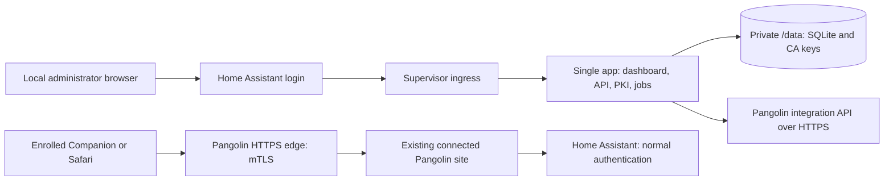

# Architecture proposal

Date: October 22, 2026. Status: architecture approved for Phase 2, with the first ingress increment implemented. Most components below remain proposed. Evidence and precise API routes are in [research.md](docs/research.md). Prototype gates are in [validation-plan.md](docs/validation-plan.md); actual results are in [phase-2-results.md](docs/phase-2-results.md).

## Deployment and trust boundaries



The app manages the access configuration; normal Home Assistant traffic does not pass through it. Its failure should not interrupt already configured remote access. All newly introduced services run in this single container. The existing site's connector is existing Pangolin infrastructure, not a new app dependency to install. If no connected site can reach Core, setup stops with a routing prerequisite. Bundling userspace Newt into this same container is a possible later extension, requiring a separate decision and prototype; do not silently require a second app.

For a connector on another machine, configure the target as the Home Assistant LAN address and port reachable **from that connector**. The app's `homeassistant` DNS alias is useful only on Supervisor's internal network. `localhost` names the current container/connector, not Core. Never route user traffic through `http://supervisor/core/api/` or forward `SUPERVISOR_TOKEN`. Core configuration, proxy trust, and any backend TLS must be checked against the actual topology. Keep `use_x_forwarded_for` and `trusted_proxies` scoped to observed legitimate proxy addresses; do not recommend trusting every LAN client. [HA network model](https://developers.home-assistant.io/docs/apps/communication/), [HTTP proxy configuration](https://www.home-assistant.io/integrations/http/).

## Runtime choices

| Component | Recommendation | Reason / remaining check |
| --- | --- | --- |
| Runtime | Node.js 24 LTS, latest security patch pinned at build | Reconfirm supported line before Phase 2; avoid a floating major |
| Backend | TypeScript, Fastify, Zod | Shared typed contracts and strict request/response validation |
| UI | React, Vite, bundled assets | No CDN or remote scripts; accessible HA-like light/dark interface |
| Metadata | Node 24 built-in SQLite, versioned migrations | Avoids a separate native extension; release-candidate API pinned/tested for this POC, reassess before production |
| PKI | OpenSSL 3.x supported distribution package; Node crypto for tokens/hashes | Established X.509 and PKCS#12 tools; no custom cryptography |
| Container | Pinned official Node Debian image, multi-stage build | One process with Supervisor init; glibc supports future SQLite packaging |
| Tests | Node test runner or Vitest; browser tests with Playwright | Choose and lock during the prototype |

Node and dependencies are now pinned in the app's toolchain/lockfile. Debian is a deliberate compatibility choice over the smaller Alpine base. Use [HA's supported image/build conventions](https://contributors.home-assistant.io/apps/guides/dockerfile/). No Redis, external database, CA server, or extra reverse proxy is needed. Node's [SQLite API](https://nodejs.org/download/release/v24.20.0/docs/api/sqlite.html) is a release candidate in the selected LTS line; this POC uses it behind a small storage service rather than adding a separately compiled addon. This changes the initial better-sqlite3 preference and must be reviewed before a production release.

## Supervisor packaging contract

Root `repository.yaml` plus a `pangolin_access/` app directory are implemented for local development. The prototype uses a pinned official Node Debian image with `init: true` so Supervisor provides init; there is no S6 or service supervisor to maintain for a single server. `boot: manual` keeps this experimental build opt-in. Other manifest settings are `startup: application`, `stage: experimental`, `ingress: true`, `ingress_port: 8099`, `backup: cold`, a graceful shutdown timeout, and no host port mappings. Retain default AppArmor and protection mode. No host networking, capabilities, devices, Docker socket, auth API, or broad Supervisor API grants. Dev.6 adds `homeassistant_api: true` for optional persistent expiry notifications through one fixed Core service endpoint. This manifest permission is granted even when notifications are disabled. Since dev.9, automatic external-URL selection can also use a fixed Core configuration read at startup; an explicit URL override avoids that read. The combined dev.9 administrator-directory client retains the token for read-only Core user-list requests even when notifications are disabled. The directory client and, when enabled, the notification sender retain the token after startup; the process environment is cleared before any child process starts. This is an application boundary, not a service-scoped platform permission. Both architectures have native build/runtime checks; live reminder delivery remains a separate check.

`/data` is the only persistent application directory; do not mount Core configuration or `/ssl`. The prototype briefly reads Supervisor options and prepares `/data/state` as root, then clears supplementary groups and drops to UID/GID 1000 before listening. Future jobs/database must handle SIGTERM by rejecting new mutations, finishing or recording jobs, closing SQLite, and deleting temporary credentials. Separate process liveness from Pangolin connectivity; a remote outage should not trigger endless restarts. The initial image health check verifies only the listening TCP socket; a Supervisor watchdog remains unimplemented rather than bypassing ingress authorization. [Manifest reference](https://contributors.home-assistant.io/apps/reference/configuration/).

Use fixed base images and build arguments in Dockerfile; current HA documentation deprecates separate `build.yaml` and no longer guarantees a supplied `BUILD_FROM`. Generate HA metadata labels through the official builder or explicitly when using another builder. Package `DOCS.md`, `CHANGELOG.md`, translations, and an AppArmor profile in Phase 4. Use semantic app versions, migration backups, and `breaking_versions` for changes requiring attention. [Build reference](https://contributors.home-assistant.io/apps/guides/dockerfile/), [presentation requirements](https://contributors.home-assistant.io/apps/guides/presentation/).

## Ingress authentication and authorization

Accept HTTP connections only from the documented Supervisor ingress peer (`172.30.32.2`, validate on the supported HA baseline). Do not trust client-supplied forwarding headers as evidence of this peer. Read identity/path headers only after peer validation. Assets, API requests, downloads, and routes must use the ingress base path; use Vite relative asset paths and hash routing. Reject arbitrary `X-Ingress-Path` values; prototype exact header behavior through the real proxy. [Ingress requirements](https://developers.home-assistant.io/docs/apps/presentation/).

Authenticated HA access alone is insufficient authority to issue credentials. Default to deny unless the trusted ingress user identifier matches an explicitly configured administrator allowlist. Dev.10 optionally permits an active HA administrator, matched to trusted ingress identity through Core, to perform setup when no configured IDs or saved selection exist. This requires explicit setup opt-in, HTTPS and an explicit CSRF-protected save retaining the actor. Until then, only setup routes are allowed. Existing installations retain their authorization boundary; optional configured IDs remain recovery access. Verify the actual forwarded identity contract in Phase 2; absent identity must fail closed. If safe per-user authorization cannot be proven, credential endpoints stay disabled until a supported administrator authorization method is designed. This is a gate, not an implemented guarantee.

Use a short-lived server-side session bound to the trusted identity and base path. Mutations require a CSRF token and expected HA origin; enforce JSON content types and reject cross-origin requests. No credential issuance by GET. Set CSP, no-store on sensitive responses, no CORS access, and no third-party assets. Restrict sensitive actions and expensive key generation by principal and global quotas.

## Pangolin adapter and reconciliation

Use the separately enabled integration API and organization-scoped bearer key over verified HTTPS. Let the administrator supply its exact base URL and organization ID. Store the key only on the backend; never return it to the browser. Fetch and validate the instance's OpenAPI specification, run read-only capability checks, and support tested API shapes rather than claiming every 1.25+ version is interchangeable.

Show a proposed diff before adopting an existing resource. V1 automates only a dedicated hostname with no assigned shared policy and no conflicting same-host routers/redirects. Shared policies may override resource settings and changes may affect other services; refuse automatic edits and explain the manual dashboard path. Do not detach a policy automatically.

Provision in durable steps: validate connectivity and permissions; choose domain/site; locate or create an un-targeted dedicated resource; persist its ID; set disabled; upload CA if fingerprint absent; enable SSL/mTLS while disabled; reread effective settings; create a disabled target; activate only after configuration review; test fresh connections with and without a client identity. If activation verification fails, disable the app-owned resource/target and report the failure. Prototype disabled resource behavior before treating it as a safety barrier. Do not attach a backend until mTLS configuration is confirmed.

Creation does not accept an app-chosen `niceId` in the inspected schema. Record intent before the call and the returned ID afterward. On an ambiguous timeout, list resources and reconcile domain/subdomain and other expected fields; if ownership cannot be established, stop for administrator reconciliation instead of retrying creation. Stable `niceId` may be assigned later using the update API. Apply the same recovery discipline to targets and CA fingerprints. Never delete unknown objects. Use a single reconciliation mutex, bounded timeouts, exponential backoff with jitter, and bounded retries for reads. Do not replay writes blindly. Re-read owned fields before a write to detect conflicts; absent upstream compare-and-swap means concurrent dashboard edits remain a risk.

Pangolin downtime leaves configuration intact and marks status stale with the last successful check time. After restart/upgrades, revalidate capabilities and desired versus actual state before changing anything. Use separate states for API reachable, configuration read back, TLS positive probe, negative probe, and user-reported device success.

## PKI and lifecycle

Start with one dedicated self-signed root directly issuing device identities. Proposed defaults: RSA 3072 with SHA-256; root valid 5 years, leaf 90 days, expiry warnings 30/14/7 days; leaf bounds 1–365 days and never beyond issuer validity. Use 128-bit positive random serials with a database uniqueness constraint and fresh keys on every issuance. CA: critical `basicConstraints CA:TRUE,pathlen:0`, critical keyCertSign/cRLSign, SKI/AKI. Leaf: critical `CA:FALSE`, digitalSignature, EKU clientAuth, SKI/AKI; opaque device identifier in subject/SAN, no fabricated DNS identity. Validate clock skew and refuse issuance on suspicious time. These are design defaults to test, not certificates generated in Phase 1.

Spawn OpenSSL using fixed executable and argument arrays, never a shell; pass passwords through pipes/file descriptors, not command arguments or logs. Construct configuration from validated structured values; bound work, output, and execution time. Reparse generated certificates and verify their chain, extensions, dates, serial and key match before committing records.

Generate leaf keys only for the export transaction. Export encrypted PKCS#12 with leaf/key and issuer certificate, start with AES-256/PBKDF2 and strong random password; prototype Apple import and benchmark iteration count. No automatic legacy crypto fallback. On successful packaging, remove raw leaf private keys; keep the encrypted package only until redemption/expiry in volatile storage. After restart or expiry, issue a replacement rather than promising redownload. Retain CA keys and public certificate history. Package delivery cannot prove installation.

Renewal produces a new identity and requires user import. Replacing or renewing does not invalidate the previous leaf. Administrative retirement, export status, expiration, and edge enforcement are separate fields. With the shared CA, individual revocation is unsupported by the inspected public mTLS interface. CA rotation requires uploading a new root, verifying overlap, re-enrolling legitimate clients, removing the old root only after the new trust is present, and verifying denial. Never remove the last trusted root. See [certificate-management.md](docs/certificate-management.md) for alternatives and active-session limitations.

## Enrollment and bootstrap

V1 uses local authenticated ingress. The new device must reach the local HA UI and an authorized administrator must perform enrollment; an administrator can alternatively transfer the encrypted package using a trusted local transfer method. The package password is displayed separately. This is an explicit bootstrap requirement, not a public URL exception on the protected hostname.

Future QR convenience links open the local HA enrollment UI and still require authentication/authorization. Generate at least 32 random token bytes, store only its hash with device/package ID, creator, expiry (5 minutes default, maximum 15), and consumed state. Put the token in a URL fragment, exchange in a CSRF-protected POST, and remove it from browser history. Do not encode an ingress session URL or key in a QR code. In one SQLite transaction, atomically consume the token before streaming the package. Exactly one redemption wins. Interrupted downloads require a fresh issuance; there is no reusable recovery URL. Set no-store and no-referrer, omit token/request bodies from logs, and purge temporary files on redemption, timeout, and startup. A QR scan or download does not mark enrollment successful.

No separate public enrollment endpoint is proposed for v1. Adding one would require its own authenticated HTTPS origin, explicit exposure controls, abuse defenses, and review. The primary mTLS hostname must never acquire an unauthenticated enrollment bypass.

## Storage, recovery, and dashboard

Planned schema: `settings`, `authorities` (generation, public PEM, encrypted-key path, state), `devices`, `certificates` (issuer/serial unique, SHA-256 fingerprint, dates, supersedes), `enrollments` (hashed token, creator, expiry, state), `pangolin_bindings`, `operations`, and append-oriented `audit_events`. Use foreign keys, migrations, transaction boundaries, and UTC timestamps. One device can have multiple historical certificates; deleting a retired display record cannot silently erase issuance or enforcement history.

Implemented POC storage is `/data/state/state.sqlite` and `/data/state/unlock.key`, with directories 0700 and files 0600. The CA key is an encrypted PKCS#8 value in SQLite; the colocated random secret permits automatic unlock. Public certificate/device metadata and audit history are not encrypted. A backup or host compromise containing both defeats signing-key encryption. Pangolin discovery and selected CA installation use an API key held in the open page and request scope without storing it. The optional API URL is stored in Supervisor options. Manual unlock remains future work. Do not claim filesystem permissions are encryption. See [SECURITY.md](SECURITY.md).

Version `0.1.0-dev.3` implements explicit, default-off CA creation, leaf issuance and short-lived `.p12` export. Generated signing inputs use `/tmp` tmpfs and finally-block cleanup; encrypted export buffers are bounded to five pending packages and cleared on use/expiry/shutdown. SQLite records hashed, actor-bound capabilities and consumes them transactionally before sending bytes; restart invalidates every pending capability. The CA is created once, and a missing or mismatched unlock secret fails closed. No renewal, rotation, private-CA export or standalone recovery import is implemented in this increment. Protected cold Supervisor backups are the current recovery mechanism; the planned standalone encrypted archive is still a release gate.

Use cold Supervisor backup initially for a consistent database/key snapshot; exclude ephemeral exports. A separate CA recovery export must include encrypted signing material, public chain, generation/serial metadata and a versioned integrity manifest, protected by a user-held recovery password through an established encrypted archive format selected/tested in Phase 2. Restore validates everything in staging, invalidates all enrollment sessions, compares live Pangolin trust before enabling writes, and never auto-publishes restored trust. Old backups can resurrect keys and stale records; live edge trust is authoritative for enforcement.

Dashboard pages: Overview, Pangolin, Devices, Certificate Authority, Settings, Diagnostics. Use HA-like colors, accessible forms, responsive layout, clear errors and no secret-bearing diagnostics. Display device platform/name, serial/fingerprint, issued/expires dates, management status and last renewal. Use explicit labels such as “retired locally — may still connect”, “trust updated — denial unverified”, and “fresh handshake rejected at [time]”. Treat reported installation separately from a verified probe. V1 cannot observe ordinary Companion handshakes without an additional trustworthy telemetry mechanism; user confirmation is labeled self-reported.

## Repository structure

The first prototype introduces the app and build folders below. PKI, database, migrations and broader test layers remain future increments:

```text
repository.yaml
pangolin_access/
  config.yaml, Dockerfile, apparmor.txt, README.md, DOCS.md, CHANGELOG.md
  translations/en.yaml
  package.json, package-lock.json
  server/                  # API, auth, PKI, storage, jobs, Pangolin adapter
  web/                     # React dashboard, relative Vite output
  migrations/
  tests/{unit,integration,security,browser}/
dev/                       # future reproducible mock/real integration harness
.github/workflows/         # future tests, scans, multiarch build/release
README.md, ARCHITECTURE.md, SECURITY.md, ROADMAP.md, AGENTS.md
docs/
```

Keep the build context compatible with Supervisor's app-directory builds; application source and lockfile live inside that directory. The current manifest builds locally and deliberately has no placeholder owner, repository URL, maintainer or published image.

## Read-only resource inspection increment

Dev.5 resolves an exact resource identifier through the supported integration resource-list query, validates the numeric resource's organization and expected hostname, then reads its inline/shared policies, bounded target list and policy CA metadata. It checks a bounded exact-host resource search and rereads selected resource fields for concurrent changes. Results are volatile browser summaries; there is no persisted adoption/binding, remote write or certificate upload. Shared policy assignments and incomplete inventories require manual review. Redirects, wildcard overlaps, manual routers, connectivity and mTLS handshakes remain separate gates. See the app setup guide for permissions and bounds.

## Named Safari profile delivery (dev.7)

The profile generator serializes a single PKCS#12 payload in an unsigned XML plist with escaped labels and a certificate-specific profile identifier. Both display names use the issued device label and actual UTC expiry month/year. No package password, MDM enrollment, root-trust payload or restrictions are emitted. Direct mobileconfig delivery uses the existing protected POST export route and Apple's configuration-profile media type. The iPhone ZIP includes both the encrypted P12 and its named profile; all formats consume the same single-use capability. No extra persistence, permission, CA change or metadata migration is introduced. Independent plist tests and simulated browser delivery are distinct from pending real iOS installation/display checks.

## Startup URL selection and advanced diagnostics (dev.9)

`startupOptionsSchema` accepts a blank/missing external URL; runtime `optionsSchema` still requires a validated exact origin. After removing the Supervisor token from the environment and dropping privileges, startup selects an explicit app override or obtains `external_url` from the fixed Core `/api/config` proxy. The fetch is read-only, bounded and no-redirect; other Core configuration is not persisted or returned. No remote hostname is contacted for discovery. Failed selection stops startup with an actionable fixed error. The stored key remains `home_assistant_origin` and existing overrides win on upgrade. Automatic mode leaves the Supervisor option blank rather than rewriting it; an ingress-protected status field shows the effective URL/source. The same strict origin/CSRF gate remains in force, independent of discovery mode.

Pangolin diagnostics mount only after opening Advanced and unmount on close, clearing form state. Supported upstream CA trust writes remain a future orchestration increment with explicit resource/policy selection and reconciliation, not part of this read-only UI.
